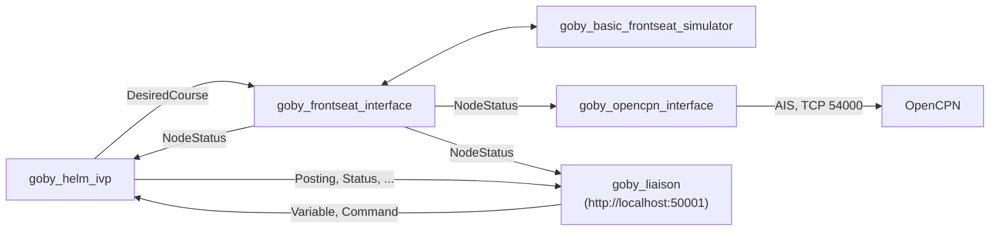

# alpha

*This section was written by Claude.*

MOOS-IvP's alpha mission (a survey, then a return) with `goby_helm_ivp` driving Goby's basic frontseat simulator, at time warp 10.



## Running

From the top of IvPico, after `./build.sh`:

```
export PATH=$PWD/build/usr/bin:$PATH
export GOBY_TOOL_LOAD_SHARED_LIBRARY=$PWD/build/usr/lib/libivpico_interface.so
cd launch/goby/alpha
goby_launch alpha.launch
./deploy.sh
```

`deploy.sh` publishes DEPLOY=true and lifts the manual override with `goby zeromq publish`, which can publish any other `Variable` or `Command` the same way.

As in MOOS-IvP's alpha, the helm parks when the survey is done (pHelmIvP's `park_on_allstop`); deploy again to return.

## Viewing in Liaison

`goby_liaison` (`config/liaison.pb.cfg`) serves http://localhost:50001:

- Map: the vehicle and its track. The helm's `Visualization`s (waypoints, ...) aren't drawn yet.
- Scope: the helm's messages (`Status`, `Posting`, ...).
- Commander: publishes a `Variable` (e.g. RETURN=true) or `Command` to the helm, as `deploy.sh` does.

## Changing the datum and time warp

```
./set_datum_warp.sh --datum 42.358456 -71.087589 --warp 5
```

sets them in every configuration, starts the vehicle at the datum, and opens Liaison's map there. With no options it prints the current settings.

## Viewing in OpenCPN

`goby_opencpn_interface` serves the vehicle's position as AIS on TCP port 54000 (`config/opencpn.pb.cfg`).

1. Install OpenCPN: `sudo add-apt-repository ppa:opencpn/opencpn && sudo apt install opencpn`.
2. In Options: Connections, add a Network connection: TCP, address 127.0.0.1, port 54000.
3. The vehicle appears as an AIS target near 43.825 N, 70.330 W. Charts are optional (Options: Charts: Chart Downloader).

See Goby's [visualization interfaces](https://github.com/GobySoft/goby3/blob/3.0/src/doc/markdown/doc507_goby_viz.md) for more.
