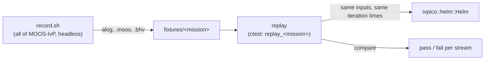
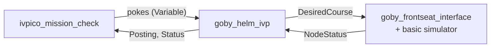

# Mission replay tests

*This section was written by Claude.*

These tests check that the IvPico helm (`src/lib/helm`) does what pHelmIvP does, using MOOS-IvP's own missions.

- `missions.txt` lists the missions and the variables poked to start them.
- `record.sh [mission...]` builds all of MOOS-IvP from `external/moos-ivp` into `build/missions`, runs each mission under pHelmIvP with time warp, and keeps each vehicle's helm inputs and outputs in `fixtures/<mission>`. The "Record missions" workflow runs it on GitHub and uploads the fixtures as an artifact.
- `replay <fixture>` feeds the recorded inputs to the IvPico helm at pHelmIvP's iteration times and compares what each helm posted. `replay.cpp` describes what's compared and the tolerances.

Re-record the fixtures whenever `external/moos-ivp` moves.

## Closed-loop runs under Goby

*This section was written by Claude.*

`goby/run.sh <mission> ...` (ctest: `closed_loop_<mission>`) flies a mission's recorded `.bhv` with `goby_helm_ivp` against Goby's basic frontseat simulator, with time warp 10:

- `goby/<mission>/helm.pb.cfg` is the helm configuration (the `.moos` file's pHelmIvP block).
- `goby/<mission>/check.pb.cfg` lists the pokes, the postings expected by a deadline, and the mission duration. Mission time starts once the helm is running and has nav.
- `IVPICO_KEEP_RUN=1` keeps the run's configs and logs.
